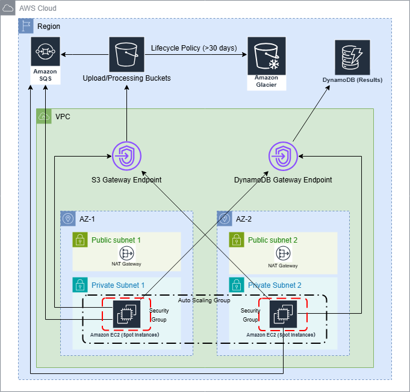
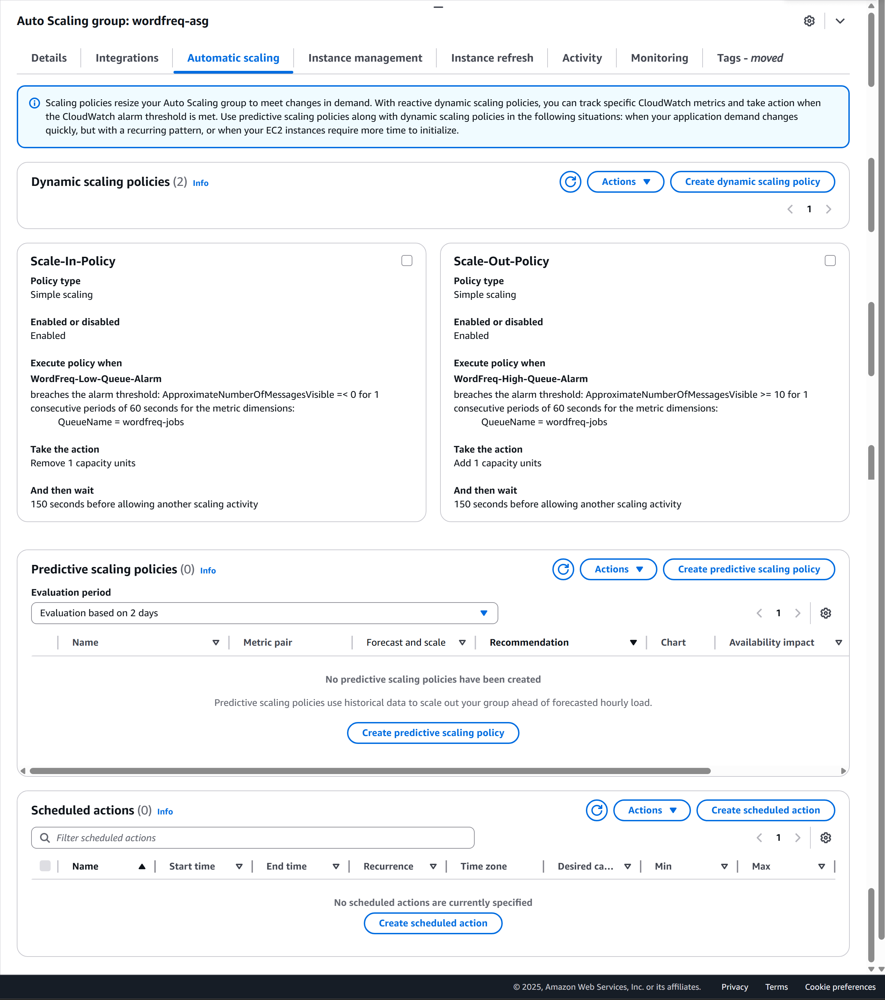
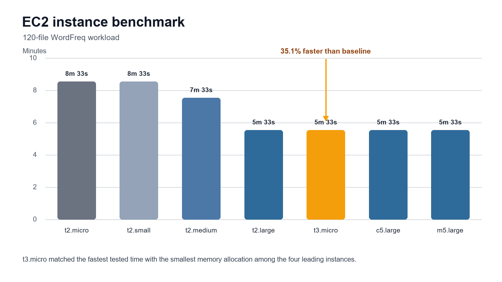

# AWS WordFreq autoscaling pipeline

I built and tested an event-driven AWS pipeline that distributes word-frequency jobs across an EC2 Auto Scaling Group. Queue depth, rather than CPU utilisation, controls capacity because the worker includes random wait time that can make CPU load a poor demand signal.

During the 120-file load test, the group expanded from one to five workers and returned to one after the queue drained. Benchmarking seven EC2 instance types reduced the recorded batch time from 8 minutes 33 seconds to 5 minutes 33 seconds, a 35.1% improvement.

## Results

| Measure | Recorded result |
| --- | ---: |
| Workload | 120 text files |
| Auto Scaling Group response | 1 -> 5 -> 1 workers |
| Queue thresholds | scale out at 10 or more visible messages; scale in at 0 |
| Cooldown | 150 seconds |
| EC2 configurations tested | 7 |
| Baseline | t2.micro, 8m 33s |
| Fastest recorded time | 5m 33s |
| Processing-time reduction | 35.1% |

## Architecture



The diagram shows the production-oriented redesign built from the tested pipeline. The load test validated the S3, SQS, EC2 Auto Scaling, CloudWatch and DynamoDB path. Multi-AZ placement, private worker subnets, VPC endpoints, archival storage and Spot capacity form the production design described later in this README.

The pipeline separates ingestion, processing and persistence:

1. Text files enter Amazon S3.
2. S3 event notifications place work on an Amazon SQS job queue.
3. EC2 workers poll SQS, stream each object from S3 and calculate word frequency.
4. Completed results are stored in Amazon DynamoDB and published to an SQS result queue.
5. CloudWatch alarms change Auto Scaling Group capacity from the visible SQS backlog.

This arrangement decouples ingestion from processing. Jobs remain in SQS while workers scale, so temporary differences between upload rate and processing capacity do not block incoming files.

## Queue-driven auto scaling

CPU utilisation was not a reliable scaling signal for this workload. The worker deliberately adds 10 to 19 seconds of latency, so an instance can be busy with a job while reporting low CPU activity. `ApproximateNumberOfMessagesVisible` measures the unfinished work directly.



The scale-out alarm added one instance when the visible backlog reached 10 messages. The scale-in alarm removed one instance when the queue returned to zero. A 150-second cooldown reduced repeated scaling while new workers were still starting. In the recorded load test, capacity moved from one worker to five and then returned to the minimum of one.

## EC2 performance benchmark



The test compared seven instance types with different vCPU, memory and platform characteristics. Moving from t2.micro to t2.small doubled memory without changing the 8m 33s processing time. t2.medium reduced the run to 7m 33s. Four configurations reached 5m 33s, including t3.micro with 1 GiB of memory.

t3.micro therefore delivered the leanest tested configuration among the fastest group. The identical 5m 33s plateau across t2.large, t3.micro, c5.large and m5.large also showed that larger instances did not improve this workload further. Inspection of the worker identified the injected `time.Sleep()` latency and SQS polling interval as the limiting factors rather than memory capacity.

The full benchmark is available in [`results/ec2-instance-benchmarks.csv`](results/ec2-instance-benchmarks.csv).

## Production-oriented redesign

The production design extends the tested pipeline for resilience, data protection, security and cost control:

- a Multi-AZ Auto Scaling Group spans two availability zones;
- private worker subnets use VPC endpoints for S3 and DynamoDB;
- S3 lifecycle rules move older objects to Glacier after 30 days;
- DynamoDB backups protect processed results;
- Spot capacity and scale-to-zero policies reduce idle compute cost where service requirements allow it.

The diagram is included as an editable draw.io file in [`architecture/optimised-wordfreq-architecture.drawio`](architecture/optimised-wordfreq-architecture.drawio).

## Application and experiment files

```text
app/            Go uploader, worker, DynamoDB setup code and service scripts
architecture/   Editable production-oriented architecture
assets/         Architecture, scaling policy and benchmark visuals
data/           Representative financial-news payloads and a small test fixture
results/        EC2 benchmark data used by the performance chart
```

The worker expects AWS credentials through the normal AWS SDK credential chain, preferably an EC2 IAM role. Runtime configuration uses these environment variables:

| Variable | Purpose |
| --- | --- |
| `AWS_REGION` | AWS region, defaulting to `us-east-1` in the scripts |
| `WORKER_QUEUE_URL` | SQS job queue URL |
| `WORKER_RESULT_QUEUE_URL` | SQS result queue URL |
| `WORKER_RESULT_TABLENAME` | DynamoDB table name |
| `WORKER_MESSAGE_VISIBILITY` | SQS message visibility timeout in seconds |

The Go source remains in the layout used for the AWS experiment. The deployment scripts under `app/deployment/` use environment variables rather than embedded credentials or account-specific queue URLs.

For the systemd worker, copy `app/deployment/worker.env.example` to `/etc/wordfreq/worker.env`, replace the account placeholder with the two queue URLs, and restrict the file to the service administrator. The service unit reads this file at startup; credentials should continue to come from the EC2 IAM role.

## Licence and source

The WordFreq application source is derived from the AWS WordFreq sample and is distributed under the Apache License 2.0. See [`NOTICE`](NOTICE) and [`LICENSE`](LICENSE).
